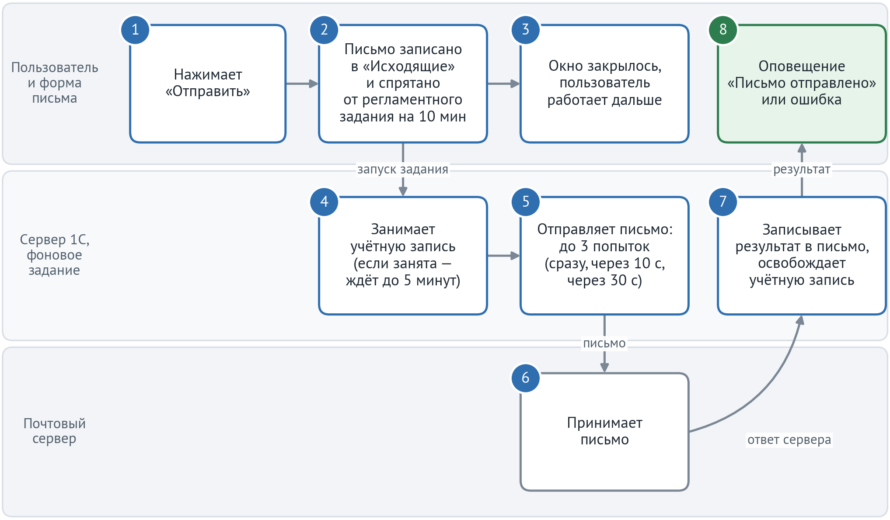
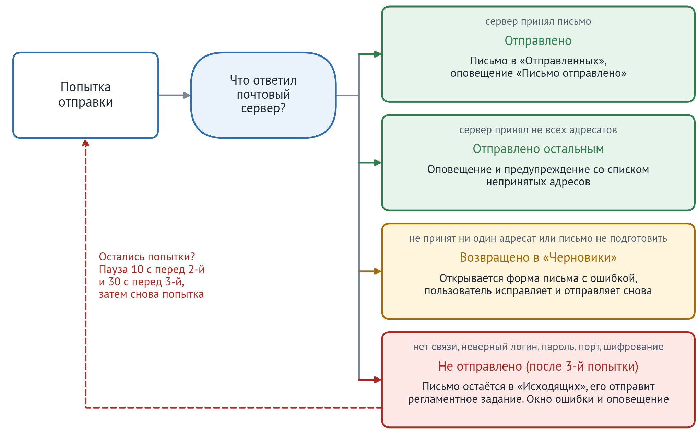
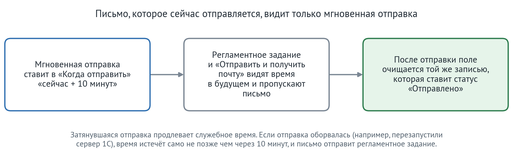

# Расширение «Мгновенная отправка писем»: техническое описание

Для программиста, который устанавливает и сопровождает расширение. Описание соответствует версии 1.0.2. Подробная спецификация поведения и все тексты сообщений — в `PRD.md`; при расхождении верен PRD.

## 1. Что делает расширение

В типовой КА кнопка «Отправить» в форме исходящего письма кладёт письмо в «Исходящие», а отправляет его регламентное задание «Получение и отправка электронных писем». С расширением форма записывает письмо, запускает фоновое задание отправки и сразу закрывается. Фоновое задание делает до трёх попыток (паузы 0, 10 и 30 секунд). Когда оно завершится, клиент показывает пользователю оповещение о результате. Для писем, которые уже лежат в «Исходящих», в форме доступна кнопка «Отправить сейчас», в том числе в клиент-серверной базе.

Кроме того, при отправке печатной формы счёта («Печать → Счет на оплату → Отправить») расширение ставит в письме тему «Счет на оплату № <номер> от <дата>», например «Счет на оплату № 123 от 20.10.2026». Типовая КА ставит тему «Счет на оплату» без номера и только для одной печатной формы, а для внешней печатной формы и «Комплекта документов» оставляет тему пустой или «Документы». Правило действует только для документов «Счёт на оплату клиенту». Если в письме несколько счетов, в теме перечислены все по дате.

Расширение не меняет:
- регламентное задание и его расписание;
- получение почты;
- команду «Отправить и получить почту»;
- рассылки и другие способы отправки.

Новых ролей, форм и настроек нет.

## 2. Состав поставки

| Что | Где |
|---|---|
| Расширение `МгновеннаяОтправкаПисем` | `build/МгновеннаяОтправкаПисем.cfe`, исходники `src/МгновеннаяОтправкаПисем/` |
| Расширение тестов `МгновеннаяОтправкаПисемТесты` (только тестовая база) | `build/МгновеннаяОтправкаПисемТесты.cfe`, исходники `src/МгновеннаяОтправкаПисемТесты/` |

Свойства расширения: назначение «Дополнение», префикс `моп_`, режим совместимости `Version8_3_21`, безопасный режим **выключен**, защита от опасных действий включена. У расширения тестов префикс `мопТ_`, безопасный режим тоже выключен.

Проверено на КА для Казахстана ред. 2, версия 2.4.5.21, БСП 3.1.7.382, платформа 8.3.23.

## 3. Как работает отправка

### 3.1. Путь письма от кнопки до оповещения

1. Пользователь нажимает «Отправить» в новом письме или «Отправить сейчас» в письме из «Исходящих». Сначала выполняются обычные проверки КА: заполнены ли адресаты, доступна ли учётная запись. Если у учётной записи не включено сохранение отправленных писем, КА, как и раньше, спрашивает, сохранять ли письмо.
2. Форма записывает письмо в «Исходящие». В поле «Когда отправить» она ставит служебное время «сейчас + 10 минут». Так регламентное задание не возьмёт это письмо, пока его отправляет расширение (п. 3.3).
3. Форма запускает фоновое задание отправки и сразу закрывается. Окна ожидания нет, пользователь работает дальше.
4. Фоновое задание занимает учётную запись письма. Если учётную запись сейчас использует регламентное задание или другая отправка, задание ждёт её до 5 минут, проверяя каждые 5 секунд (п. 3.4).
5. Задание передаёт письмо почтовому серверу. Если сервер не ответил, задание повторяет попытку (п. 3.2).
6. Почтовый сервер принимает письмо или отвечает ошибкой.
7. Задание записывает результат в письмо: статус «Отправлено», дату отправки, очищает служебное время. Только после этого оно освобождает учётную запись.
8. Программа пользователя всё это время ждала задание в фоне. Когда задание закончилось, она показывает оповещение «Письмо отправлено» или сообщение об ошибке.

В коде шаги 1–3 выполняет форма письма (`моп_ОтправитьПисьмоКлиент` и `моп_ОтправитьМгновенно`) и серверная функция `НачатьОтправку`, шаги 4–7 — фоновая процедура `ОтправитьПисьмоВФоне`, шаг 8 — модуль `моп_МгновеннаяОтправкаПисемКлиент`.

### 3.2. Попытки и итоги отправки

Задание делает до трёх попыток: первую сразу, вторую через 10 секунд, третью ещё через 30 секунд. Повторяются только ошибки, которые могут пройти сами или после исправления настроек: почтовый сервер не ответил, не принял логин или пароль, неверные порт или шифрование. Если сервер отверг адресатов или письмо не удалось подготовить (например, не читается вложение), повтор не поможет, и письмо сразу возвращается пользователю в «Черновики».

| Итог | Что с письмом | Что видит пользователь |
|---|---|---|
| Отправлено | В «Отправленных» с датой приёма сервером. Если у учётной записи нет сохранения и пользователь выбрал «Отправить», письмо удаляется | Оповещение «Письмо отправлено» |
| Отправлено частично | В «Отправленных»; непринятых адресатов обрабатывает типовая `ОбработатьОшибкуОтправкиПисьма` | Оповещение и предупреждение со списком непринятых адресов |
| Возвращено в черновики | «Черновик», флажок «Включать текст исходного письма» снят; регламентное задание его не отправляет | Открывается форма письма с ошибкой |
| Не отправлено | Остаётся в «Исходящих» без служебного времени; его отправит регламентное задание | Окно ошибки и оповещение «Письмо не отправлено» |
| Прекращено | Не меняется | Ничего |

«Прекращено» бывает, если за время отправки письмо удалили, пометили на удаление, вернули в черновики, сменили в нём учётную запись или поставили в «Когда отправить» более позднее время. «Не отправлено» бывает также, если учётная запись не освободилась за 5 минут или истёк срок «Не отправлять после».

### 3.3. Почему письмо не уйдёт дважды

Регламентное задание и команда «Отправить и получить почту» в начале работы одним запросом выбирают письма для отправки и потом их статус не перепроверяют. Письма с «Когда отправить» в будущем этот запрос пропускает. Поэтому расширение на время отправки ставит в это поле служебное время «сейчас + 10 минут»:

- Черновик получает служебное время той же записью, которая переводит его в «Исходящие» (`&После("ПередЗаписьюНаСервере")` формы).
- Письмо, которое уже лежало в «Исходящих», прячет `НачатьОтправку`. Регламентное задание или «Отправить и получить почту» могли взять его в работу ещё до этого. Поэтому, если они запущены раньше, отправка ждёт, пока они закончат.
- Когда до служебного времени остаётся меньше 5 минут, отправка продлевает его.
- Поле очищается той же записью, которой записывается результат отправки.
- Если пользователь сам поставил в поле время позже служебного, отправка прекращается без уведомления, а его время остаётся.

Кроме того, одно письмо не могут отправлять два фоновых задания сразу: у задания ключ `моп_ОтправкаПисьма_<УникальныйИдентификатор письма>`. Повторное нажатие «Отправить сейчас» во время отправки выводит «Письмо уже отправляется».

### 3.4. Блокировка учётной записи

Учётная запись занимается так же, как в типовой КА: записью в регистре сведений `ЗаблокированныеДляПолученияУчетныеЗаписи` по правилу 60 минут из `УправлениеЭлектроннойПочтой.ЗаблокироватьУчетнуюЗапись`. Отличий два.

Первое: в клиент-серверной базе запись моложе 60 минут считается действующей, только если жив тот, кто мог её поставить. Это может быть:
- регламентное задание;
- фоновое задание команды «Отправить и получить почту»;
- более ранняя мгновенная отправка с той же учётной записью (наименование задания `Мгновенная отправка письма (<UUID учётной записи>)`).

Если никого из них нет, например сервер 1С перезапускался во время отправки, запись считается брошенной, и следующая отправка сразу её забирает. В файловой базе запись моложе 60 минут считается действующей всегда.

Второе: отправка удаляет запись регистра только после записи результата в письмо и только если `ДатаБлокировки` в ней всё ещё её собственная.

## 4. Объекты расширения

| Объект | Назначение |
|---|---|
| `моп_МгновеннаяОтправкаПисемКлиентСервер` | `ДоступностьОтправки` — чистая функция правил «можно ли отправлять сейчас» и текстов отказа. Её используют и форма (видимость «Отправить сейчас»), и сервер |
| `моп_МгновеннаяОтправкаПисем` (сервер) | Всё остальное: правила без обращения к базе, блокировка учётной записи, служебные записи письма, `НачатьОтправку`, фоновая процедура `ОтправитьПисьмоВФоне` |
| `моп_МгновеннаяОтправкаПисемВызовСервера` | `СостояниеОтправки` — для клиента, если фоновое задание завершилось аварийно |
| `моп_МгновеннаяОтправкаПисемКлиент` | Ожидание фонового задания без формы-владельца и показ результата |
| `моп_ОтправкаСчетовНаОплату` (сервер) | Тема письма со счётом: `ТемаПисьмаСчетов` — чистая функция текста темы, `ЗаполнитьТемуПисьма` — проверка объектов печати и запись темы в параметры письма |
| Общий модуль `УправлениеПечатьюПереопределяемый` (заимствован) | Перехват `&После("ПередОтправкойПоПочте")`: только вызывает `ЗаполнитьТемуПисьма`. Эту точку расширения БСП вызывает форма печати документов перед созданием письма |
| Форма `Документ.ЭлектронноеПисьмоИсходящее.ФормаДокумента` (заимствована) | Перехват кнопки отправки и видимость «Отправить сейчас»; два реквизита формы: `моп_РаботаСВнешнимиРесурсамиЗаблокирована`, `моп_МгновеннаяОтправка` |

Процедуры каждого модуля по пунктам описаны в разделе «Техническая реализация» `PRD.md`.

## 5. Зависимости от типовой КА

Этот раздел нужен при обновлении КА: здесь перечислено, на что опирается расширение и что из этого замечает каждая проверка.

### 5.1. Заимствованные объекты

- `Документ.ЭлектронноеПисьмоИсходящее` и его форма `ФормаДокумента`.
- Общий модуль `УправлениеПечатьюПереопределяемый`: перехвачена только процедура `ПередОтправкойПоПочте` (см. п. 5.2).
- Без изменений, только потому что на них ссылается форма:
  - журнал `Взаимодействия`;
  - общая картинка `КоллекцияПиктограммФайлов`;
  - перечисление `ВариантыВажностиВзаимодействия`;
  - справочник `Пользователи`;
  - реквизиты документа `Важность`, `ДатаОтправления`, `Ответственный`, `ОтправительПредставление`, `Тема`, `Комментарий`, `ДатаКогдаОтправить`, `ДатаАктуальностиОтправки`.

Изменение этих объектов в КА покажет проверка применимости расширения.

### 5.2. Перехваченные процедуры формы письма

`&ИзменениеИКонтроль` не используется, только `&Перед`, `&После` и `&Вместо`. Поэтому изменение тела типовой процедуры проверка применимости **не** покажет: покажет только её удаление или переименование.

- **`ОтправитьПисьмоКлиент`**, `&Вместо`.
  - Что делает расширение: вся развилка отправки — черновик или «Исходящее», доступна отправка или нет.
  - На что рассчитывает: вопрос «Отправить / Отправить и сохранить» задаёт `ОтправитьВыполнить` **до** этой процедуры. Типовая процедура при `ОтправлятьСообщенияСразу = Истина` отправляет письмо синхронно, поэтому для недоступного «Исходящего» `ПродолжитьВызов()` не вызывается.
- **`ОпределитьВидимостьДоступностьЭлементовВЗависимостиОтСтатусаПисьма`**, `&После`.
  - Что делает расширение: заполняет `моп_РаботаСВнешнимиРесурсамиЗаблокирована` и включает доступность кнопки `Отправить` у «Исходящего».
  - На что рассчитывает: у существующего письма эту процедуру вызывает `ПриЧтенииНаСервере` раньше, чем `ПриСозданииНаСервере`.
- **`УправлениеДоступностью`**, `&После`.
  - Что делает расширение: видимость «Отправить сейчас» и «Записать и закрыть» у «Исходящего».
  - На что рассчитывает: `ТолькоПросмотр` к этому моменту уже выставлен.
- **`ПередЗаписьюНаСервере`**, `&После`.
  - Что делает расширение: ставит служебное время в «Когда отправить», когда черновик переходит в «Исходящие».
  - На что рассчитывает: при `ВыполняетсяОтправка = Истина` типовой код сам ставит статус «Исходящее» и один раз вставляет цитату исходного письма.
- **Событие `ПриИзменении` поля `ДатаАктуальностиОтправки`**, обработчик `После`.
  - Что делает расширение: пересчитывает видимость «Отправить сейчас».

- **`УправлениеПечатьюПереопределяемый.ПередОтправкойПоПочте`**, `&После`.
  - Что делает расширение: подставляет тему «Счет на оплату № … от …», если все объекты печати — «Счёт на оплату клиенту».
  - На что рассчитывает: форма печати документов (`ОбщаяФорма.ПечатьДокументов`) вызывает эту процедуру после типового заполнения параметров письма и передаёт в `ОбъектыПечати` массив ссылок. Тему, которую поставила КА, расширение заменяет. Если БСП изменит сигнатуру или перестанет её вызывать, проверка применимости покажет первое, но не второе. Второе заметит тест `ПередОтправкойПоПочте_Счет`.

Из типовой формы также используются переменные `ОтправлятьСообщенияСразу` и `ВыполняетсяОтправка`, таблица `Вложения` (колонки `Расположение`, `Редактируется`, `Ссылка`), элементы `Отправить` и `ФормаЗаписатьИЗакрыть`. Заголовок «Отправить сейчас» по-прежнему задаёт типовая `УстановитьЗаголовокКнопкиПоУмолчанию`.

### 5.3. Вызываемые типовые процедуры и данные

Вызываются из кода расширения без заимствования:

- `УправлениеЭлектроннойПочтой`: `ОбработатьОшибкуОтправкиПисьма`, `ПараметрыОбработкиОшибкиОтправки`, `СобытиеЖурналаРегистрации`;
- `Взаимодействия`:
  - `ПараметрыПисьмаДляОтправки`, `ОценитьРазмерИсходящегоЭлектронногоПисьма`, `ПредставлениеПисьма`;
  - `ОпределитьПапкуДляПисьма`, `ОпределитьПапкуДляПисьмаПоУмолчанию`, `УстановитьПапкуЭлектронногоПисьма`;
- `ВзаимодействияКлиентСервер.ТемаВзаимодействия`;
- `ПрефиксацияОбъектовКлиентСервер.НомерНаПечать` (номер счёта в теме такой же, как на печатной форме счёта);
- `РаботаСПочтовымиСообщениями`: `ПодготовитьПисьмо`, `ОтправитьПисьмо`;
- форма `Справочник.УчетныеЗаписиЭлектроннойПочты.Форма.ПроверкаНастроекУчетнойЗаписи`: открывается с теми же параметрами, что передаёт `РаботаСПочтовымиСообщениямиКлиент.СообщитьОбОшибкеПодключения`;
- БСП: `ДлительныеОперации`, `ДлительныеОперацииКлиент`, `БлокировкаРаботыСВнешнимиРесурсами.РаботаСВнешнимиРесурсамиЗаблокирована`, `РаботаСФайламиКлиент.ПоместитьПрисоединенныйФайл`, `ОбщегоНазначения*`, `Пользователи.АвторизованныйПользователь`;
- регистры сведений:
  - `ЗаблокированныеДляПолученияУчетныеЗаписи`;
  - `НепринятыеКОбработкеПочтовымСерверомИсходящиеПисьма` (сюда регламентное задание пишет отказ по письму; «Отправить сейчас» этот отказ снимает);
  - `ПредметыПапкиВзаимодействий` (блокировка при установке папки);
- регламентное задание `ПолучениеИОтправкаЭлектронныхПисем`: его активные фоновые задания ищутся по `ИмяМетода`.

**Зашито строкой:** фоновое задание команды «Отправить и получить почту» ищется по наименованию «Получение и отправка электронной почты пользователя». Его задаёт `ВзаимодействияВызовСервера` при запуске. Если обновление КА изменит это наименование, мгновенная отправка перестанет видеть команду. Тогда возможна двойная отправка письма, которое команда уже взяла. Это не ловят ни проверка применимости, ни тесты. Строку нужно сверить вручную, см. п. 8.

### 5.4. Поведение типового кода, на которое опирается расширение

- Печатная форма счёта из «Счёта на оплату клиенту» выводит номер через `НомерНаПечать`, а тему письма типовая КА заполняет в `ФормированиеПечатныхФорм.СформироватьТемуИТекстПисьма` до вызова `ПередОтправкойПоПочте`.
- Регламентное задание и «Отправить и получить почту» не берут письма с «Когда отправить» в будущем. На этом построена защита от двойной отправки.
- `ОбработатьОшибкуОтправкиПисьма` сама пишет в журнал регистрации и не меняет статус письма. В черновики письмо возвращает расширение.
- Типовой `ПередЗаписьюНаСервере` добавляет цитату исходного письма при каждой «отправочной» записи черновика и не снимает флажок «Включать текст исходного письма». Поэтому при возврате в черновики расширение снимает этот флажок.
- Типовой `ПередЗаписью` формы помещает правленые вложения асинхронно, то есть уже после записи письма и запуска задания. Поэтому форма помещает их сама до записи.
- Форма держит блокировку редактирования письма с первой правки до закрытия, даже после `Записать()`. Перед запуском отправки расширение снимает эту блокировку (`РазблокироватьДанныеДляРедактирования`).
- В режиме отладки БСП `ДлительныеОперации.ВыполнитьВФоне` выполняет процедуру синхронно в сеансе пользователя. Тогда пауз между попытками и ожидания учётной записи нет.

## 6. Установка, обновление, отключение

**Установка:**
1. Конфигуратор → «Конфигурация → Расширения конфигурации → Добавить → Загрузить из файла» → `МгновеннаяОтправкаПисем.cfe`.
2. **Снять «Безопасный режим»** у расширения. В безопасном режиме расширение не может отправлять письма, а окна при этом открываются без ошибок. Защиту от опасных действий оставить включённой.
3. Обновить конфигурацию базы данных.
4. Проверить в списке расширений: версия совпадает с переданной, «Активно» отмечено, «Безопасный режим» снят, «Защита от опасных действий» отмечена. Создать новое исходящее письмо: окно открывается без ошибок.
5. Пользователям перезайти.

**Обновление:** выделить `МгновеннаяОтправкаПисем` в списке расширений и загрузить новый `.cfe` из файла, не удаляя расширение. Затем обновить конфигурацию БД, проверить список расширений, как в шаге 4, и попросить пользователей перезайти.

**Аварийное отключение:** снять «Активно» у расширения и попросить пользователей перезайти. Обновлять БД не нужно, удалять расширение тоже. После этого «Отправить» работает как в типовой КА. Письма, которые отправлялись в момент отключения, отправит регламентное задание: служебное время в «Когда отправить» истечёт само не позже чем через 10 минут.

Расширение тестов в рабочую базу не устанавливается.

## 7. Тесты

Тесты написаны на YAXUnit (в `ka-demo` проверено на 25.12), в общих модулях `мопТ_МгновеннаяОтправкаПисем` и `мопТ_ОтправкаСчетовНаОплату`, 101 тест. Их можно запускать только в тестовой базе, где уже установлены YAXUnit и оба расширения.

**Условия запуска:**
- под администратором;
- регламентное задание «Получение и отправка электронных писем» выключено;
- никто не запускает «Отправить и получить почту».

Блокировку работы с внешними ресурсами снимать не нужно.

**Ожидаемый результат:**
- все тесты зелёные, пропущенных нет;
- пропущенный тест означает, что в базе шло получение почты, и прогон нужно повторить;
- ноль выполненных тестов или `[ERR]` в журнале YAXUnit означают ошибку компиляции модуля тестов: YAXUnit такой модуль молча пропускает.

**Что тесты проверяют:**
- правила доступности отправки и их тексты;
- правила служебного времени и блокировки учётной записи, включая границы 10 и 60 минут;
- все служебные записи письма;
- ветки фоновой отправки до обращения к почтовому серверу;
- поиск активных фоновых заданий;
- тему письма со счётом: один и несколько счетов, другой документ, счёт вместе с другим документом, несуществующий счёт, пустые объекты печати;
- что вызываемые процедуры КА не изменились: подготовка письма, обработка непринятых адресатов, текст «<Без темы>».

**Что тесты не проверяют:**
- саму отправку по сети;
- всплывающие оповещения;
- наименование задания команды «Отправить и получить почту» из п. 5.3.

Это проверяют сценарии приёмки.

Тесты не отправляют писем: учётные записи в них несуществующие. Данные они пишут в транзакции с откатом. В журнале регистрации тесты оставляют ошибки по письмам «мопТ: тестовое письмо», это нормально.

## 8. После каждого обновления КА

1. Проверка применимости расширения в конфигураторе: ошибок нет.
2. Сверить в обновлённой КА наименование задания «Получение и отправка электронной почты пользователя» в `ВзаимодействияВызовСервера` (п. 5.3).
3. Если в описании обновления упомянута форма исходящего письма, сверить с п. 5.2 перехваченные процедуры и поведение, на которое опирается расширение.
4. Тесты YAXUnit в тестовой базе: все зелёные, пропущенных нет.
5. Сценарии приёмки П1, П3, П5, П6, П10, П15, П17, П35 из `PRD.md`.

## 9. Диагностика

| Что смотреть | Где |
|---|---|
| Ошибки отправки | Журнал регистрации, событие «Взаимодействия», уровень «Ошибка». В данных — ссылка на письмо, в комментарии — номер попытки и текст ошибки. Ожидание занятой учётной записи пишется одной записью, если оно превысило 5 минут |
| Идёт ли отправка письма | Фоновые задания (консоль кластера) с наименованием `Мгновенная отправка письма (<UUID учётной записи>)` и ключом `моп_ОтправкаПисьма_<UUID письма>` |
| Письмо «застряло» в «Исходящих» | В поле «Когда отправить» служебное время не дальше 10 минут вперёд означает, что идёт мгновенная отправка или она прервалась. После этого времени письмо отправит регламентное задание |
| Учётная запись занята | Регистр сведений «Заблокированные для получения учетные записи». Запись удаляет та отправка, которая её поставила; брошенную запись в клиент-серверной базе следующая отправка перехватывает сама |
| Регламентное задание не берёт письмо | Регистр «Непринятые к обработке почтовым сервером исходящие письма». «Отправить сейчас» снимает отказ |

## 10. Известные ограничения

- Тема «Счет на оплату № … от …» подставляется только при отправке печатных форм документов «Счёт на оплату клиенту». Для письма, созданного вручную, и для печатных форм других документов тема остаётся как в КА.
- Уведомление показывается только в сеансе, из которого запущена отправка. Если пользователь закрыл программу, результат виден только по статусу письма и в журнале регистрации.
- В файловой базе прерванная отправка не продолжается: письмо отправит регламентное задание после истечения служебного времени. Кроме того, «Отправить сейчас» там не видит задания других пользователей, поэтому небольшой риск двойной отправки остаётся.
- Если сервер принял письмо, но соединение оборвалось до подтверждения, письмо может уйти адресату повторно. Так же работает и типовая КА.
- Для IMAP-учётной записи без сохранения отправленных на сервере каждая неудачная SMTP-попытка может оставить лишнюю копию в папке «Отправленные» на сервере, всего до трёх.
